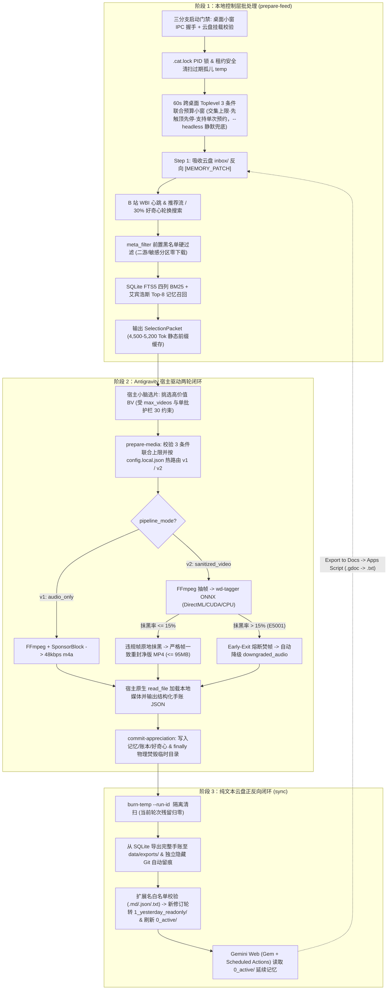

# GeminiNest

> **面向 Google Antigravity 原生多模态宿主的自主 B 站冲浪、本地视觉安检、桌面常驻交互与持续记忆数字生命系统。**
>
> *An autonomous Bilibili surfing, local visual safety-gated, desktop companion-assisted, and bounded cross-platform memory digital life system built for Google Antigravity's native multimodal host — zero external LLM API keys, hot-swappable between v1 Pure-Audio (`48kbps m4a`) and v2 Sanitized-Video (`wd-tagger` DirectML GPU + Surgical Blackout MP4), with v3 Win32 tray companion, 4-condition intersection budget control, and 3-branch startup gate.*

[](#v1-纯音频-vs-v2-可插拔视觉安检门)
[](#user--ai-agent-通用快速部署清单quickstart-checklist)
[-brightgreen.svg)](#step-4离线验货--dry-run-与-172-条单元测试)
[](LICENSE)

---

## 项目亮点与架构差异

传统的「AI 刷视频 / 自动化冲浪」脚本通常依赖浏览器轮询截图 + 循环调用外部视觉 API，容易导致多轮工具乒乓（Token 爆炸）、账单失控、误传违规画面，且记忆随会话结束清零。**GeminiNest** 从底层架构做了五项核心反转：

| 对比维度 | 传统截图轮询 / 外置 API 脚本 | GeminiNest（v3.0 架构） |
| :--- | :--- | :--- |
| **控制流与 Token 成本** | Agent 反复调工具抓页、截多图（280–1,120 Tok/张），多轮乒乓 Token 失控 | **控制权反转（IoC）**：本地 Python 批处理拉取、黑名单过滤、记忆预检索与媒体封装，Agent 压缩为 **「选片 + 鉴赏」极简两轮**，并拼装 `4,500–5,200 Tokens` 字节级稳定静态前缀命中隐式缓存 |
| **模型接入与费用** | 强依赖外置 LLM SDK 与按量付费 API Key，多模态流量费用高昂 | **Antigravity 宿主原生 `read_file` 零额外 API 费**：零外置 LLM SDK、零 Gemini API Key，直接复用 Antigravity Pro 订阅原生读取本地 `.m4a` / `.mp4` |
| **长期记忆与遗忘机制** | 堆叠全量历史聊天导致上下文膨胀，缺乏检索与遗忘衰减 | **SQLite FTS5 + 艾宾浩斯 Top-8 记忆引擎**：四列 BM25 加权（标题/简介/热评/新评）+ `<3` 字中文短词回退 + 印象分驱动的遗忘曲线衰减，每次注入严格封顶 Top-8（3 全局 + 5 关联） |
| **跨端同步与安全隔离** | 原图/原片或数据库直传云端，极易触发 `SAFETY` 截断或泄露私密文件 | **四重防护 + Google Drive 纯文本物理隔离闭环**：前置元数据硬黑名单 → 本地 `wd-tagger` 全帧安检与外科手术抹黑 → 临时媒体两阶段用完即焚 → 云盘纯文本白名单（仅 `.md`/`.json`/`.txt`）打通 **Antigravity ↔ Gemini Web** 正反向记忆闭环 |
| **定时唤醒与预算风控** | 隔离桌面（`exebox-*`）弹窗不可见、无启动门禁易半途空跑、虚假 5h 百分比不准 | **v3.1 常驻桌面托盘 + 3 条件本地联合预算 + 主动限额设置**：`WinSta0\Default` 轻量小窗展示真实累计/今日冲浪与互动统计（含「限额设置」设为默认值/单次使用预约）；3 维度交集上限（`max_run_tokens` / `max_videos` / `max_minutes`）先触顶先停；开跑前强制校验小窗在线与云盘挂载 |

---

## v1 纯音频 vs v2 可插拔视觉安检门

### 为什么采用「本地抽帧 + 音轨重封 MP4」与「强硬前置安检」？

1. **为什么不直接喂原片，也不传散装多图，而是抽帧重封净版 MP4？**
   - **顺应原生机理，榨干 Token 与带宽效率**：Gemini 原生处理视频本质上也是按固定帧率抽帧 + 音轨联合编码。本地提前按 `480p @ 1fps + 48kbps` 重封，既能把动辄几十上百 MB 的 B 站原片压到 **2–3 MB**（轻松落入 100 MB Inline 直传上限，省去上传带宽与外部存储链路），又能直接享受视频通道 **`70 Tokens/帧`** 的计费档位——相比散装多图输入（`280–1,120 Tokens/张`）**暴省 4–16 倍 Token**，同时保留原生音画时间轴对齐。
   - **严格帧一致安检（Frame Parity）**：直接传原片无法保证每一帧都安全；抽帧过检后再用过检帧重封，能 100% 保证「本地 `wd-tagger` 检过哪几帧，模型看到的 MP4 里就严格只有哪几帧」。

2. **为什么默认强硬屏蔽二游/擦边分区，并叠加本地安检与云盘纯文本隔离？**
   - **核心目的不是内容偏好，而是「保号防误判」**：Google 账号体系（含云盘与多模态通道）对未成年人保护 / CSAM（儿童色情）采用极严苛的自动化风控机制，而大量二次元/二游角色普遍带有**幼态画风（萝莉/少年体型）或清凉服饰**，极易触发自动化风控的**严重误判，轻则 `SAFETY` 截断，重则连坐导致整个 Google 主账号被永久封禁**。
   - 因此本项目构建了「**元数据黑名单前置硬拦截（零下载）→ 本地 `wd-tagger` 逐帧安检与外科抹黑/降级 → Google Drive 纯文本物理隔离**」三道保号防线；黑名单词库均配置在 `config.json` 中，使用者可在充分评估自身账号风控承受能力的前提下自行增删。

`config.json` 出厂默认采用零额外视觉依赖的 **v1 纯音频模式**；升级到 **v2 净版视频模式**无需修改任何业务代码或定时任务 Prompt，只需在本地私有 `config.local.json` 中热插拔切换开关即可。

| 维度 | v1 纯音频模式（`audio_only`） | v2 净版视频模式（`sanitized_video`） |
| :--- | :--- | :--- |
| **感知载体** | 元数据 + 字幕 + 精选评论 + **`48kbps` 单声道 `m4a`**（SponsorBlock 自动去广告） | 元数据 + 字幕 + 精选评论 + **480p 1fps 严格帧一致净版 MP4**（含 `48kbps` 单声道音轨） |
| **本地安检引擎** | `PassthroughSafetyGate`（零视觉依赖、零视觉合规风险） | **`wd-tagger` ONNX**（`SmilingWolf/wd-vit-tagger-v3`），支持 `DirectML`（Windows 通用 GPU）/ `CUDA` / `CPU` 自动路由 |
| **安全兜底机制** | 严守**纯听觉诚实红线**（禁止脑补未提供的画面细节） | 三重阈值（`general ≥ 0.20`、`sensitive ≤ 0.75`、`unsafe ≤ 0.05`）→ 违规帧原地**外科手术抹黑 `(0,0,0)`** → 抹黑率 `> 15%` 触发 **Early-Exit 提前熔断**并自动降级为 `downgraded_audio`（`E5001`） |
| **实测体积与估算 Token** | 110s 视频 → **`680 KB` `m4a`**；按 25 Tok/s 估算总计 `3,264 Tokens`（**本地公式估算 / 特定环境观测值**，非服务端官方计费遥测） | 133s（132 帧）视频 → **`2.73 MB` 净版 MP4**（`2,858,964` 字节）；按 70 Tok/帧 + 25 Tok/s 估算总计 `13,040 Tokens`（**本地公式估算 / 特定环境观测值**，非服务端官方计费遥测） |
| **实测管线耗时** | 秒级完成 FFmpeg 抽音与空降裁剪 | **Windows DirectML GPU 端到端 `21.77 s`**（下载 `2.51 s` + 抽帧 `5.61 s` + 132 帧推理 `12.43 s` + 重封 `0.67 s`）；单帧热态推理 **`51.75 ms`**（较 CPU `360.76 ms` 提速 **7.0×**，端到端较 CPU `291.15 s` 提速 **13.4×**） |

### 热插拔切换方式

在本地私有 `config.local.json` 中切换以下字段即可随时往返于 v1 / v2（定时任务 Prompt 完全通用，无需修改）：

```json
{
  "project": {
    "pipeline_mode": "sanitized_video"
  },
  "safety_alignment": {
    "wd_tagger_enabled": true,
    "wd_tagger_model_path": "data/models/model.onnx",
    "wd_tagger_device": "auto"
  }
}
```

> 切回 v1 时，仅需把 `"pipeline_mode"` 改回 `"audio_only"`、`"wd_tagger_enabled"` 设为 `false`。

---

## 系统架构流程图



---

## 项目目录结构（公版追踪 vs 本地私有隔离）

### 1. Git 追踪的公版文件（随仓库开源发布）

```text
GeminiNest/
├── .agent/rules/cat-soul.md          # 核心人设、感知诚实与审美规范（静态前缀缓存基石）
├── config.json                       # 全局非敏感默认配置（出厂默认 v1 audio_only）
├── config.local.example.json         # 本地路径与 v1/v2 私有覆盖示例模板
├── .env.example                      # B 站只读小号 Cookie 环境变量模板（零 Gemini API Key）
├── .gitignore                        # 严格屏蔽凭据、私有配置、数据库、模型权重与临时媒体
├── pyproject.toml                    # pytest 路径与离线测试配置
├── requirements.txt                  # v1 最小依赖（yt-dlp / httpx / python-dotenv / winotify）
├── requirements-v2.txt               # v2 视觉安检与冷备依赖（onnxruntime / pillow / numpy / py7zr）
├── requirements-dev.txt              # 离线单元测试依赖（pytest）
├── LICENSE                           # MIT 开源许可证
├── README.md                         # 项目门面与通用部署清单
├── ARCHITECTURE.md                   # 全局架构设计白皮书
├── SPEC_AND_TASKS.md                 # 模块契约、18 项错误码表与分阶段里程碑
├── HANDOFF_LOG.md                    # 架构决策与阶段验收交接记录
├── docs/
│   └── SETUP_AND_RUNTIME.md          # v1/v2/v3 运维部署、Antigravity 定时 Prompt 与 Web 联动手册
├── assets/
│   └── gemininest.ico                # 桌面小窗与 Win32 系统托盘自定义图标
├── scripts/
│   ├── create_companion_shortcut.py  # 一键在 Windows 桌面生成无黑框小窗启动快捷方式（支持 --dry-run）
│   ├── download_wd_tagger.py         # wd-tagger ONNX 权重与标签 CSV 离线友好下载校验器
│   └── inbox_gdoc_exporter.gs        # Google Apps Script 云端 .gdoc -> .txt 定时转换脚本
├── src/gemininest/
│   ├── contracts.py                  # 全模块不可变 DTO 与 18 项统一 ErrorCode
│   ├── config.py                     # 配置合并校验（黑名单并集追加 + Secrets repr 脱敏）
│   ├── meta_filter.py                # NFKC + casefold 前置黑名单硬拦截防火墙
│   ├── memory_store.py               # SQLite WAL + FTS5 trigram (<3 字回退) + 艾宾浩斯 Top-8 + 账本
│   ├── fetcher.py                    # B 站 WBI API / yt-dlp / SponsorBlock / -412 熔断 / 默认关闭的受控自用交互
│   ├── media_processor.py            # FFmpeg v1 音频裁剪 / v2 抽帧与严格帧一致净版 MP4 重封 / 用完即焚
│   ├── safety_gate.py                # v1 Passthrough 桩 / v2 wd-tagger ONNX (DirectML/CUDA/CPU + Early-Exit)
│   ├── agent_bridge.py               # 静态前缀缓存拼装 / Packet 打包 / JSON Schema 校验 / 账本估算
│   ├── budget_ui.py                  # 3 条件联合上限 UI 面板与主动限额设置（Tk/Toplevel 复用）+ 原子 IPC + 120s TTL Toast 转发
│   ├── companion.py                  # WinSta0\Default 常驻轻量 tkinter 桌面小窗 + Win32 系统托盘（单实例互斥锁 + 状态看板 + IPC 监听）
│   ├── sync_manager.py               # 纯文本扩展名防火墙 + exports 独立隐藏 Git + 轮转 + inbox 补丁吸收
│   └── runner.py                     # .cat.lock PID 锁、三分支启动门禁、只读 status 接口与 --dry-run 离线回放
└── tests/                            # 全离线单元测试（零网络、零真实数据触碰）
```

### 2. `.gitignore` 严格屏蔽的本地私有文件（严禁提交至 Git）

| 本地路径（不会出现在公开仓库） | 用途说明 |
| :--- | :--- |
| `.env` | B 站只读小号 `BILI_SESSDATA` / `BILI_JCT` / `BILI_BUVID3` 本地凭据 |
| `config.local.json` | 本机 `ffmpeg_binary`、`cloud_nest_dir`、`extra_blacklist` 与 v1/v2 开关覆盖 |
| `.agent/rules/cat-soul.local.md` | 可选的个人私有性格微调叠层（自动追加至静态前缀 Block 1，不污染公版规则） |
| `data/cat_memory.db`（及 `-wal`/`-shm`） | 本地 SQLite 长期记忆、世界书、观看史与 5 小时算力账本 |
| `data/models/`（`model.onnx`、`selected_tags.csv`） | v2 `wd-tagger` 本地 ONNX 权重（约 361 MB） |
| `data/exports/`（含内部独立 `.git/`） | 导出的纯文本手账与独立隐藏 Git 历史仓库（物理隔绝主代码库） |
| `data/temp/`、`data/snapshots/`、`data/budget_ipc/`、`data/*.lock` | 两阶段用完即焚临时媒体目录、离线黑匣子快照、跨桌面 IPC 文件目录与 `.cat.lock` / `.companion.lock` 进程锁 |

---

## User / AI Agent 通用快速部署清单（Quickstart Checklist）

本项目**不附带任何隐式一键安装脚本**，所有初始化动作均透明可控。无论是人工按清单执行，还是直接交由 AI Agent 自动接管部署，请严格依次完成以下 5 步：

### 交给 AI Agent 自动接管安装的引导提示词

如果你正在使用 Google Antigravity、Cursor、Claude Code 等 Coding Agent，克隆仓库后可直接把下面这段话发给它：

> 请阅读当前仓库的 `README.md` 和 `docs/SETUP_AND_RUNTIME.md`，严格按照「User / AI Agent 通用快速部署清单」帮我完成部署：先检查本机 `conda` / `python`（3.11）与 `ffmpeg` 可用性，创建 `gemininest` 环境并安装我指定的依赖（默认 v1，若我要启用 v2 视觉模式请安装 `requirements-v2.txt` + `onnxruntime-directml` 并下载 `wd-tagger` 权重），拷贝缺失的 `.env` 与 `config.local.json`（不覆盖已有文件），然后运行 `--dry-run` 离线验货和 `pytest` 确认 163/163 通过；遇到需要填写 B 站小号 Cookie、本机路径或 Google Drive 目录时请暂停并列出待填项交给我手动填写，严禁将任何凭据写入 Git。

---

### Step 1：克隆仓库并创建 Python 3.11 独立环境

- [ ] 确认本机已安装 **FFmpeg**（支持 `aac`、`m4a`、`libx264`、`mp4`，且建议在 `PATH` 中可见或记录完整路径 `<YOUR_FFMPEG_PATH>`）。
- [ ] 克隆代码并创建独立 Python 3.11 环境（推荐 Conda，亦可使用标准 `venv`）：

```powershell
git clone https://github.com/e-ter-nal/GeminiNest.git
cd GeminiNest

# 方式 A：Conda（推荐）
conda create -n gemininest python=3.11 -y
conda activate gemininest

# 方式 B：Python 标准 venv（若未使用 Conda）
# python -m venv .venv
# .\.venv\Scripts\Activate.ps1
```

### Step 2：安装依赖（v1 纯音频 或 v2 视觉安检门）

- [ ] **基础必装（v1 纯音频 + 离线测试）**：

```powershell
pip install -r requirements.txt
pip install -r requirements-dev.txt
```

- [ ] ***(可选) 升级 v2 视觉安检门（`wd-tagger` ONNX）***：任选一种推理后端，并下载本地权重至 `data/models/`：

```powershell
# 方案 A（Windows 通用 GPU 推荐：DirectML，支持 NVIDIA/AMD/Intel，免装 CUDA Toolkit）
pip install -r requirements-v2.txt
pip uninstall -y onnxruntime
pip install onnxruntime-directml

# 方案 B（纯 CPU 环境）
# pip install -r requirements-v2.txt

# 方案 C（已配置完整 CUDA/cuDNN 的 NVIDIA 环境）
# pip install -r requirements-v2.txt
# pip uninstall -y onnxruntime
# pip install onnxruntime-gpu

# 下载并校验 wd-tagger 权重（约 361 MB；网络受限可加 --mirror https://hf-mirror.com）
python scripts/download_wd_tagger.py
```

### Step 3：拷贝本地私有配置模板并填写关键项

- [ ] 从模板生成本地私有文件（两者均已被 `.gitignore` 严格忽略，**严禁提交至 Git**）：

```powershell
# PowerShell（Linux/macOS 请改用 cp）
Copy-Item .env.example .env
Copy-Item config.local.example.json config.local.json
```

- [ ] 编辑 `.env`：在浏览器**无痕窗口**登录 B 站**只读小号**，填入 `BILI_SESSDATA`、`BILI_JCT`、`BILI_BUVID3`（无需任何 Gemini API Key）。
- [ ] 编辑 `config.local.json`：
  - 将 `media_preprocess.ffmpeg_binary` 设为你的 `<YOUR_FFMPEG_PATH>`（若已在 `PATH` 中可留 `"ffmpeg"`）；
  - 将 `sync.cloud_nest_dir` 设为你的 Google Drive 本地同步目录 `<YOUR_GOOGLE_DRIVE_NEST>`，并在该目录下创建 `0_active`、`1_yesterday_readonly`、`inbox`、`inbox_archived` 四个空子目录；
  - 若需启用 v2 视觉安检，按上方「热插拔切换方式」补充 `pipeline_mode: "sanitized_video"` 与 `wd_tagger_enabled: true`。
- [ ] 确认代理分流：B 站域名（`bilibili.com`、`bilivideo.com`、`hdslb.com`）走 `DIRECT` 直连，Google / Antigravity 走单一稳定节点。

### Step 4：离线验货（`--dry-run`）与 172 条单元测试

在接入真实小号与定时任务前，先运行全离线演练与单元测试（全程使用隔离临时沙箱，**零网络请求、零额度消耗、绝不触碰真实数据库与云盘**）：

- [ ] 运行离线闭环演练：

```powershell
$env:PYTHONPATH = "src"

# v1 纯音频离线闭环演练
python -m gemininest.runner --dry-run --headless

# v2 视觉安检 + 净版 MP4 + E5001 自动降级离线闭环演练
python -m gemininest.runner --dry-run --mode sanitized_video --headless
```

- [ ] 运行全量离线单元测试（确认 **172/172** 全部通过）：

```powershell
python -m pytest -v
```

### Step 5：选择启动模式并配置 Antigravity 定时巡逻

项目并列支持以下两种启动方式（详情与标准唤醒 Prompt 请参阅 [`docs/SETUP_AND_RUNTIME.md`](docs/SETUP_AND_RUNTIME.md)）：

- **方式 ①：桌面小窗交互模式（推荐，解决隔离桌面 `exebox-*` 弹窗不可见问题）**：
  1. 在 `gemininest` 环境下运行一键桌面快捷方式生成脚本（零黑框启动 `pythonw.exe -m gemininest.companion`）：
     ```powershell
     python scripts/create_companion_shortcut.py
     # 可先追加 --dry-run 预演确认解析路径
     ```
  2. 双击桌面的「**GeminiNest 桌面小窝助手**」快捷方式常驻真实桌面（`WinSta0\Default`）：支持随时切换「**每次弹窗询问**」与「**自动默认值执行**」、点击「**限额设置**」调整默认 3 项限额或预约下次「**单次使用**」、后台异步刷新 `runner status`（当前模式 / 累计与今日冲浪互动统计 / 429 冷却 / 云盘挂载 / 手账数）、以及 120s TTL 原生 Toast 代发。
  3. 在 Antigravity **`Scheduled Tasks`** 使用 **`Create With Prompt`** 粘贴 `docs/SETUP_AND_RUNTIME.md` 第 3.3 节「标准唤醒 Prompt」（默认不带 `--headless`，触发前自动执行小窗在线校验、云盘挂载门禁与跨桌面 3 条件联合预算弹窗）。
- **方式 ②：`--headless` 纯无头自动化模式（或显式 CLI 预算覆盖）**：
  - 无需打开桌面小窗，直接在 `prepare-feed` 与 `commit-appreciation` 后追加 `--headless`（按默认或单次预约 3 项限额静默执行，跳过交互弹窗与 Toast），或传入 `--max-tokens` / `--max-videos` / `--max-minutes` 任意组合（未传维度本轮自动不限）；在线巡逻仍会在开跑前强制校验 Google Drive 云盘挂载状态（`require_cloud_mount_on_start: true`）。
- ***(可选) 云端联动***：
  1. 部署 [`scripts/inbox_gdoc_exporter.gs`](scripts/inbox_gdoc_exporter.gs) 至 Google Apps Script（每 15 分钟将 `inbox/` 中的 `.gdoc` 转存为同名 `.txt`）；
  2. 配置 Gemini Web 端常驻 Gem 与每日 `Scheduled Actions`，实现手机/网页端与本地记忆的纯文本双向闭环。

---

## 合规与免责声明

1. **仅供学习与个人研究（默认纯只读 + 可选极低频自用互动）**：本项目仅面向个人多模态 Agent 架构学习、本地媒体安检与长期记忆实验研究。**公版 `config.json` 出厂保持纯只读，所有写操作开关（`interaction.*`）默认全部关闭（`false`）**；代码库**严禁且绝不实现任何自动评论（`/x/v2/reply/add`）、`@` 提及、关注或刷量功能**。如使用者在本地 `config.local.json` 手动开启低频自用互动（仅限点赞、私密收藏与向单一目标大号 `owner_bili_uid` 私信分享），必须严格遵守每日频率上限与风控熔断保护，因违规或高频操作引发的一切账号风险与后果均由使用者自行承担。
2. **遵守平台服务条款与法律法规**：使用者须严格遵守 Bilibili、Google Antigravity、Google Drive 及相关第三方平台的服务条款与所在地法律法规，因违规操作、滥用或违反平台协议引发的任何账号风控、封禁或其他后果均由使用者自行承担。
3. **妥善保管个人凭据与隐私**：请仅在浏览器无痕窗口提取只读小号 Cookie，绝勿使用主力账号；严禁将 `.env`、`config.local.json`、`data/cat_memory.db`、模型权重或任何含个人隐私/凭据的文件提交至公开仓库或上传至云盘常规同步目录。

---

## License

本项目基于 [MIT License](LICENSE) 开源。
